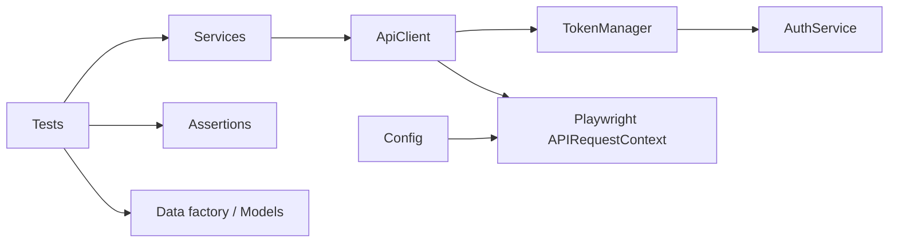

# Playwright API Automation (Python)

API test automation framework built with **Playwright for Python** + **pytest**, testing the
[EventHub API](https://api.eventhub.rahulshettyacademy.com).

## Tech stack

| Tool | Purpose |
|------|---------|
| [Playwright (Python)](https://playwright.dev/python/docs/api-testing) | HTTP client (`APIRequestContext`) |
| pytest | Test runner, fixtures, markers, parametrization |
| python-dotenv | Loads local `.env` configuration |
| pytest-html | HTML report (`reports/report.html`) + JUnit XML |
| ruff | Linting and formatting |

## Project structure

```
playwright-api-automation/
├── api_framework/                  # Reusable framework code (no tests here)
│   ├── config.py                   # 1. Settings from environment variables
│   ├── endpoints.py                # 2. All API routes in one place
│   ├── models.py                   # 3. Request payloads (dataclasses)
│   ├── data_factory.py             # 4. Builds valid test data with overrides
│   ├── core/
│   │   ├── api_client.py           # 5. HTTP wrapper: auth header, 401 retry, logging
│   │   └── token_manager.py        # 6. Central token cache + auto-regeneration
│   ├── services/
│   │   ├── auth_service.py         # 7. One method per auth endpoint
│   │   └── events_service.py       # 7. One method per events endpoint
│   └── assertions.py               # 8. Reusable assertions with clear messages
├── tests/
│   ├── conftest.py                 # Wires the building blocks together as fixtures
│   ├── test_auth.py
│   ├── test_events.py
│   └── test_token_management.py
├── .env.example                    # Template for local configuration
├── pyproject.toml                  # pytest + ruff configuration
└── requirements.txt
```

## How the layers fit together

Each layer is small, does one job, and only depends on the layer below it.



| Layer | Knows about | Does **not** know about |
|-------|-------------|-------------------------|
| `ApiClient` | HTTP, tokens, logging | Endpoints, business rules |
| Services | Endpoints, payloads | Assertions, tokens |
| Tests | Business expectations | HTTP details, tokens |

A test therefore reads like a specification:

```python
def test_create_event(events_service, cleanup_events, city):
    payload = build_event(city=city)

    response = events_service.create_event(payload)

    assert_status(response, HTTPStatus.CREATED)
    body = response.json()
    cleanup_events.append(body["data"]["id"])
    assert_success(body, expected_message="Event created successfully")
    assert body["data"]["city"] == city
```

## Token management

The token is handled centrally by `TokenManager` (one instance per test session, exposed via the
`token_manager` fixture). Tests never log in or set headers themselves.

1. **First request** – `ApiClient` asks `TokenManager.get_token()`; it logs in and caches the token.
2. **Next requests** – the cached token is reused (no extra logins).
3. **Proactive refresh** – the token's JWT `exp` claim is read. If the token expires within
   `TOKEN_REFRESH_BUFFER_SECONDS`, a new one is generated before the request is sent.
   (If the token is not a JWT, `TOKEN_TTL_SECONDS` is used as the lifetime.)
4. **Reactive refresh** – if the server still answers `401`, `ApiClient` calls
   `TokenManager.refresh_token()` and retries the request **once** with the new token.

These behaviours are verified in [tests/test_token_management.py](tests/test_token_management.py).

## Setup

Requires Python 3.11+. **No configuration is needed** – a dummy test account and the base URL
are built into [api_framework/config.py](api_framework/config.py).

### Quickest way (one command)

The script creates the virtual environment, installs dependencies and runs the tests:

```powershell
cd playwright-api-automation
powershell -ExecutionPolicy Bypass -File run_tests.ps1            # Windows
bash run_tests.sh                                              # macOS/Linux
```

Any pytest arguments can be appended, e.g. `run_tests.ps1 -m smoke`.

### Manual setup

```powershell
cd playwright-api-automation
python -m venv .venv
.\.venv\Scripts\Activate.ps1        # macOS/Linux: source .venv/bin/activate
pip install -r requirements.txt
pytest
```

### Overriding defaults (optional)

To use another account or environment, set `BASE_URL`, `API_USER_EMAIL` or
`API_USER_PASSWORD` as environment variables, or copy `.env.example` to `.env` (git-ignored)
and edit it.

> No browser download is needed: Playwright's API testing does not launch a browser.

### Running from VS Code

Install the **Python** extension (Microsoft), reload the window, and open the **Testing** view
(flask icon). Tests are discovered automatically via `.vscode/settings.json`.

## Running tests

```powershell
pytest                       # all tests
pytest -m smoke              # only smoke tests
pytest -m regression         # only regression tests
pytest tests/test_events.py  # single file
pytest -k create_event       # by name
```

Reports are written to `reports/report.html` and `reports/junit.xml`.
Request/response logs are printed live, with `password` and `token` values masked.

## Code quality

```powershell
ruff check .        # lint
ruff format .       # format
```

## CI – GitHub Actions

Workflow: [.github/workflows/playwright-api-automation.yml](../.github/workflows/playwright-api-automation.yml)

- Runs on push / pull request when files in `playwright-api-automation/` change.
- Can be triggered manually (**Actions → Playwright API Automation → Run workflow**) with an
  optional marker, e.g. `smoke`.
- Steps: install deps → ruff lint/format check → pytest → upload HTML/JUnit reports as artifacts.
- No secrets are required; the built-in dummy account is used.

## Adding a new test

1. **New endpoint?** Add the route to `endpoints.py` and a method to a service in `services/`.
2. **New payload?** Add a dataclass to `models.py` and a builder to `data_factory.py`.
3. **Write the test** in `tests/` using the service fixture (e.g. `events_service`) and helpers
   from `assertions.py`. Register cleanup for any data you create.
4. Tag it with `@pytest.mark.smoke` or `@pytest.mark.regression`.

## Conventions

- Services return the raw Playwright `APIResponse`; **assertions live only in tests**.
- Configuration lives in one place (`config.py`) and can be overridden by environment variables.
- Tests are independent: each creates its own data and cleans it up.
- Type hints everywhere; code formatted and linted by ruff.
